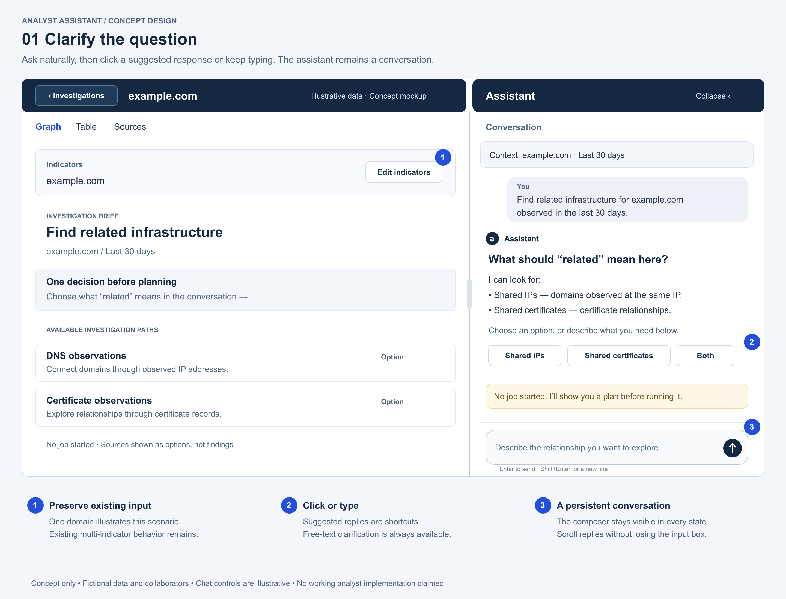
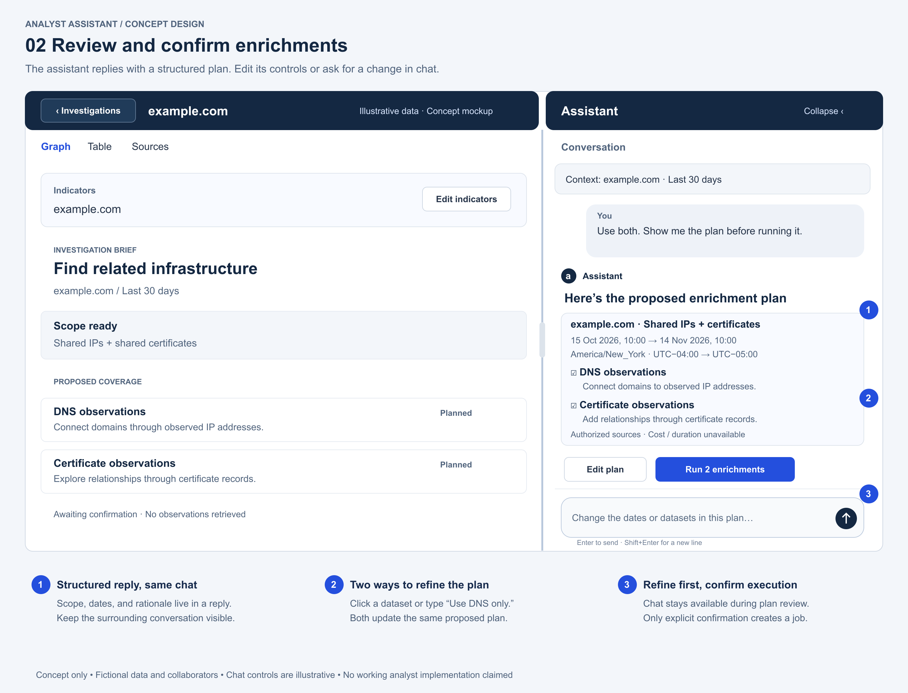
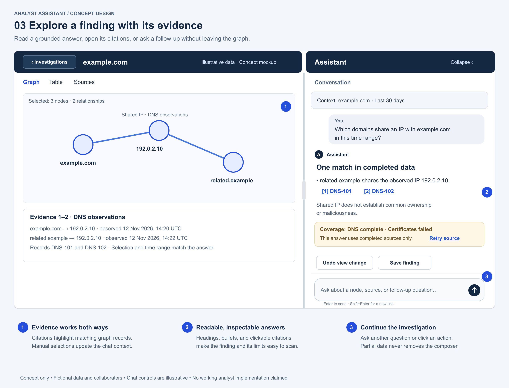
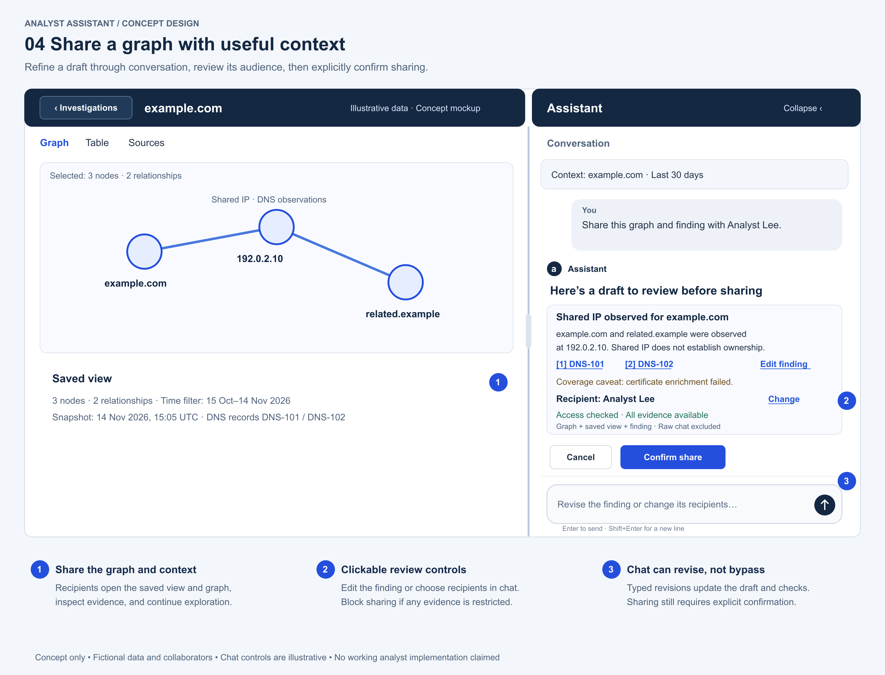

# PRD — Cyber Analyst Assistant

**Author:** Jeffrey Sidebottom
**Date / version:** November 14, 2026 / 0.5  
**Status:** Draft for review. Annotated visual mockups are conceptual; no customer research or analyst implementation is claimed.

## 1. Proposal and problem

Build an assistant inside the existing cyber analytics workspace that helps analysts turn a question into a reviewable enrichment plan, explore graph evidence, and share a finding with its context.

The platform already supports powerful analysis through tables and graphs. The opportunity is to reduce the effort required to translate an investigative objective into application actions. Success means reaching a correctly supported finding faster while preserving the analyst's ability to inspect, correct, and explain the work.

**Primary user:** An analyst who understands the question they want to investigate but does not know every enrichment dataset or graph control. **Secondary user:** A collaborating analyst who needs to understand and verify a shared finding.

| Current workflow | Pain hypothesis | Intended improvement |
|---|---|---|
| Enter an IP/domain, choose enrichments, submit a job | Dataset selection requires knowledge of which sources answer which questions | Translate intent into an explicit, editable plan with dataset rationale |
| Explore a large knowledge graph for patterns | Repeated navigation and filtering obscure the investigative question | Ask bounded questions and see the corresponding graph evidence |
| Share a graph and collaborate | Recipients must reconstruct the original analyst's reasoning | Share a saved view and a concise finding linked to evidence |

These pain points are hypotheses to validate with users. Before committing to production scope, observe three to five representative investigations with SMEs and analysts of differing experience. Identify frequent questions, costly mistakes, and the point where natural language offers an advantage over direct manipulation.

**Assumptions to validate:** Existing job, graph, and sharing capabilities can be invoked through supported interfaces; dataset metadata and user entitlements are available; source records can be linked from graph results. Dataset names and results in the mockups below are illustrative.

## 2. Goals, boundaries, and priority

1. Reduce time to a correctly supported finding on supported investigation tasks.
2. Help analysts understand and control the requested operations before execution.
3. Make findings reproducible and understandable to authorized collaborators.

| Priority | Capability | Why it matters |
|---|---|---|
| P0 — MVP | Start an investigation using natural language and review suggested enrichments | Helps analysts translate their question into an investigation |
| P0 — MVP | Ask questions about the graph and inspect supporting evidence | Reduces navigation effort while keeping findings verifiable |
| P0 — MVP | Refine the investigation through follow-up questions and manual controls | Lets analysts iterate without losing context or control |
| P0 — MVP | Save and share findings with relevant evidence | Helps collaborators understand and continue the work |
| P1 — V1 | Expand supported questions and add saved investigation recipes | Builds on the tasks that demonstrate value in the pilot |
| P2 — V2 | Proactive suggestions and more complex multi-step investigations | Requires stronger evaluation and demonstrated demand |

**MVP boundary:** Preserve the platform's existing indicator-entry capabilities. The single-domain scenario below illustrates a workflow; it does not impose a one-indicator limit. Confirm existing multi-indicator behavior during discovery and preserve it where supported; adding new batch capabilities is not assumed. Initial graph operations cover direct neighbors, shared infrastructure, and time filters. Follow-ups may refine those operations using the active investigation context. SMEs and engineering must validate the supported operation set before delivery.

**Non-goals:** Replacing graph/table views, autonomous investigations, arbitrary generated queries, automatic sharing, or inferring maliciousness from a relationship alone. Shared infrastructure is not proof of common ownership or intent.

## 3. Proposed experience and low-fidelity mockups

The primary experience is a two-panel workspace:

- **Investigation panel:** Graphs, tables, source records, and saved findings.
- **Assistant panel:** Persistent inline chat for questions and follow-ups, with structured enrichment plans, evidence links, progress, and confirmation controls.

Before results exist, the investigation panel shows a synchronized investigation brief: entered indicators, time range, unresolved relationship scope, and available source paths. During plan review it summarizes the proposed coverage and what each source contributes. Label options and planned sources distinctly from retrieved evidence; no placeholder findings or inferred result counts. Once execution returns data, graph/table/source views show actual results.

The assistant uses a familiar conversational layout: user messages, assistant replies with concise paragraphs, headings or bullets where useful, and clearly clickable evidence citations. Enrichment plans, suggested responses, and sharing controls appear inline within assistant replies. Users may click those controls or type a follow-up to refine the same draft or view; neither interaction mode replaces the other.

A persistent message composer stays visible and editable beneath the independently scrolling conversation in every expanded-panel state, including plan review, enrichment progress/partial failure, evidence exploration, and sharing review. Preserve typed drafts during progress and recoverable errors. Follow-ups do not silently alter a running job or execute a revised plan. Sending a message that requests execution or sharing produces or updates a reviewable action; explicit confirmation is still required.

A persistent “Investigations” navigation option lets users return to previous investigations from any workflow state. The investigation list is not shown in these mockups. Opening a previous investigation restores its authorized workspace context and applies the same context-isolation rules.

Panels are resizable; the assistant is collapsible to give complex graphs more room. The investigation panel receives more space by default; validate exact proportions with users. Suggested prompts expose supported actions without requiring users to know application terminology.

Both panels share the active investigation, selected entities, and time range. Selecting a node lets the analyst ask about it; selecting a chat citation opens or highlights evidence; a filter request updates the workspace. Follow-ups retain context, and manual changes are reflected in the assistant's visible scope. Switching investigations clearly changes the context and does not carry evidence or selected entities from the previous investigation into a new answer. Users can continue working through manual controls at any time.

### Annotated visual mockups

These conceptual screens use fictional data. Each shows a persistent composer, distinct user/assistant messages, and inline controls or evidence links. They show interaction intent, not a working analyst implementation.



**Figure 1 — Clarify.** Preserve existing indicator entry; answer a focused question by clicking a suggested reply or typing.



**Figure 2 — Review plan.** Review a structured assistant reply; edit controls or type a change before explicit execution confirmation.



**Figure 3 — Explore evidence.** Read a formatted reply with clickable citations, inspect synchronized graph evidence, or type a follow-up while partial-source failure stays visible.



**Figure 4 — Collaborate.** Refine the share draft through chat or inline controls; confirm the saved view, graph, evidence, caveats, and recipients after access review.

### A. State the question and review the plan

```text
INVESTIGATION WORKSPACE                   ASSISTANT
Graph | Table | Sources                   "Find related infrastructure observed
                                          for example.com in the last 30 days."
Seed: example.com
                                          REVIEW PLAN
Investigation brief                       Seed: example.com
Proposed source coverage                  Time range: Last 30 days [Edit]
                                          [x] DNS observations
                                          [x] Certificate observations

                                          DNS connects domains and IPs.
                                          Certificates may add relationships.
                                          Authorized datasets only.
                                          Estimated duration: unavailable
                                          [Edit plan] [Run 2 enrichments]
```

Relative dates resolve to explicit timestamps and a displayed time zone before confirmation. If “related” cannot be mapped safely, the assistant asks a focused question such as “Shared IPs, shared certificates, or both?” It does not silently broaden scope. Unsupported requests explain the limit and offer a supported prompt or manual path.

### B. Explore evidence in place

```text
INVESTIGATION: example.com                 ASSISTANT
Graph | Table                             "Show domains sharing an IP with
                                          example.com in this time range."
 [example.com] ---- [192.0.2.10]
                         |                1 matching domain in completed data:
                [related.example]         related.example [Evidence 1, 2]

Selected: 3 nodes / 2 edges                [Highlight matches] [Undo view change]
                                          Shared IP does not establish ownership.
DATA STATUS
DNS: complete                             [Save finding]
Certificates: failed [Retry]
Results reflect completed sources only.
```

All entities/results are fictional. Selecting evidence opens the source record, observation time, and supporting relationship. The graph/table and answer stay synchronized. A zero-result response says “No matching observations in the available data,” not “No relationship exists.” Retrying a failed enrichment is an explicit action with applicable scope/cost confirmation.

### C. Share context with control

```text
SHARE FINDING
Title: Shared IP observed for example.com
View: saved selection + filters + data version/time
Finding: [editable text with evidence references]
Recipients: [Choose existing authorized collaborators]

Access check: all included evidence must be available to recipients.
Partial data: certificate enrichment failed; caveat included.
[Cancel]                                  [Confirm share]
```

The MVP saves a versioned view and an editable finding with evidence references. Recipients can open the shared knowledge graph, inspect the saved view and evidence, and continue exploration through the existing collaboration features. The saved finding is a contextual entry point into that shared investigation; it does not replace graph sharing. Raw assistant chat is not shared by default. If any included evidence is unavailable to a recipient, block sharing that finding and explain how to remove the recipient or produce a permitted version; do not silently expand permissions or leave restricted facts in the summary.

**UX details:** Confirm actions that create jobs or share information; allow reversible graph filters without repeated confirmation. Show progress and preserve user input during errors. Support keyboard navigation, visible focus, text status labels, and a table alternative to graph-only interaction.

## 4. Functional requirements and acceptance criteria

All requirements below are P0. They describe the proposed product, not completed implementation.

| ID | Requirement | Acceptance criteria |
|---|---|---|
| A1 | Interpret supported intent into a reviewable plan | Given valid indicator input supported by the platform and a supported request, show the indicators, absolute time range, datasets, and rationale. Invalid or ambiguous input prompts correction before any job starts. Unavailable datasets are excluded. |
| A2 | Execute only the confirmed plan | Editing scope updates the plan before submission. A single confirmation creates one job, including on repeated clicks/retry after a transient response failure. No enrichment starts from merely typing a prompt. |
| A3 | Answer supported questions from authorized graph data | Each factual relationship claim links supporting records. Clicking a reference selects the relevant graph elements. Unsupported questions or missing evidence produce an explicit limitation rather than an invented answer. |
| A4 | Keep incomplete results and view changes understandable | When a source fails, successful data remains usable with a persistent caveat. A view change can be undone. A retry does not imply the investigation was previously complete. |
| A5 | Save and share an inspectable finding | Save selection, filters, data version/time, evidence references, and caveats. Authorized collaborators can open and explore the shared knowledge graph using existing collaboration controls. Require recipient review and explicit confirmation. Recheck access when sharing and opening; no restricted facts appear in generated text. |
| A6 | Keep the two panels and follow-up context synchronized | A selected entity and time range are visible as question context. Supported follow-ups reuse that context; manual scope changes are reflected before the next request. Evidence links open the matching records. Changing investigations cannot mix prior evidence into the new answer. Resizing or collapsing chat preserves the active investigation. |
| A7 | Preserve chat input and conversational interaction across every workflow | The expanded assistant always shows an editable composer; scrolling replies does not hide it. Plan review, progress, partial failure, and sharing never replace chat with a standalone form. Users can revise a proposed plan or sharing draft using text or inline controls, with both reflecting the same current state. Replies use readable structure and clickable source citations. Draft input survives recoverable errors; job execution and sharing still require explicit confirmation. |

The assistant may request approved operations; application services validate their parameters and permissions before executing. Retrieved text is evidence, never authority to change operations or bypass access controls. Model/provider choice remains an engineering evaluation, not a prerequisite product decision.

### Responsiveness and routing hypothesis

**Product requirement:** Common requests should receive fast, evidence-backed responses. Requests requiring additional analysis should show progress and preserve the user's context. Ambiguous requests require clarification; missing data requires an explicit limitation or a proposed enrichment for confirmation. More reasoning is not a substitute for unavailable evidence.

**Implementation hypothesis:** Evaluate lightweight intent classification and adaptive routing before presenting an answer. A classifier identifies the requested operation and possible handling path; it does not establish the factual answer or grant permission. A familiar graph filter may use a supported operation directly, an explanation may require evidence retrieval and generation, and a complex supported question may benefit from deeper reasoning. Every path retains the same authorization, evidence, and action-confirmation requirements; routing cannot expand supported product scope.

Use evaluated signals of intent, complexity, ambiguity, and evidence sufficiency to select a path. Validate any confidence thresholds against representative tasks rather than treating a model's self-reported confidence as proof of correctness. Users can request further analysis, but should not be the primary mechanism for detecting inadequate first answers.

Engineering should compare adaptive routing with a simpler baseline on matched requests, measuring end-to-end response time, task correctness, cost per successful task, and misrouting or unnecessary escalation. Adopt routing only if the benefits exceed its overhead without reducing quality. No classifier vendor, model family, or multi-classifier architecture is mandated by this PRD.

## 5. Execution and rollout

| Stage | Work and owners | Exit gate |
|---|---|---|
| Discovery and feasibility | PM observes workflows; SMEs define intents, source semantics, and correctness rubric; engineering verifies graph/job/sharing interfaces | Supported intent list, evidence model, and dependencies agreed; narrow scope if interfaces cannot support it |
| UX validation | PM/design test the mockup with representative analysts | Participants can explain the plan, correct scope, inspect evidence, and predict sharing outcomes without coaching |
| MVP delivery | Engineering integrates constrained operations; SMEs create evaluation cases; PM defines instrumentation | A1–A7 acceptance checks pass, including ambiguity, partial failures, access changes, and investigation-context isolation |
| Limited pilot | Feature-flagged access for a small analyst group; compare matched tasks with existing UI | Quality and access guardrails pass and time-to-finding improves before broader availability |
| V1 / V2 | Expand supported work based on pilot evidence | Each additional intent passes the same correctness and permission evaluations |

Sequence dependencies and resolve interface feasibility before estimating sprint dates. If reliability fails in the pilot, disable assistant execution while keeping existing manual workflows available.

## 6. Success metrics and evaluation

All baselines are unknown. The targets below are proposed pilot hypotheses or release criteria, not measured results. Use matched investigation tasks with an SME-scored answer rubric; counterbalance task order to reduce learning effects and include incomplete-data cases. Report failures and timeouts separately so faster successful tasks cannot hide lower completion.

| Type | Metric and definition | Proposed target / measurement |
|---|---|---|
| Output — primary | Median elapsed time from task start to an SME-verified, correctly supported finding, among successful tasks | At least 25% lower than existing UI on supported tasks; measure with task success alongside it |
| Output | Successful tasks / all assigned tasks | At least current-UI baseline; SME scores evidence validity and completeness |
| Input | Investigations using a supported assistant action / eligible pilot investigations | Diagnose adoption weekly; no adoption-only launch gate |
| Input | Confirmed plans reaching completed or explicitly partial results / confirmed plans | Track job completion and correction/abandonment separately; investigate failures before expansion |
| Guardrail | Unsupported relationship claims / evaluated relationship claims | Zero in the release evaluation set; any observed material unsupported claim triggers review and restriction of the affected intent |
| Guardrail | Unauthorized disclosures in answers, evidence, or shared findings | Zero; any confirmed incident pauses the affected capability |
| Guardrail | p95 end-to-end response time for common graph questions, including routing/retrieval/generation overhead | Initial hypothesis: at most 5 seconds; report deeper-analysis requests separately with progress feedback, and enrichment runtime separately |
| Guardrail | Enrichment and assistant cost / correctly completed task | Track against manual baseline; agree acceptable ceiling with engineering/business before pilot |

Instrument plan proposed/edited/confirmed, job status, supported query completed/failed, evidence opened, finding saved, and share completed/blocked. If routing is introduced, also record selected path, fallback/escalation, and time to a usable answer. Evaluate misrouting and unnecessary escalation against SME-labeled cases; these are diagnostics, not standalone success metrics. Record operation IDs, timing, and status; avoid collecting raw sensitive prompts or findings in general analytics. Evidence-open rate is diagnostic, not a requirement to click more.

## 7. Risks, trade-offs, and open questions

| Risk / trade-off | Decision and mitigation |
|---|---|
| Confirmation adds a step | Confirm job creation and sharing because mistakes have consequences; keep reversible exploration fast |
| Incorrect interpretation or persuasive unsupported explanation | Bounded intents, editable plans, source references, uncertainty and coverage caveats, SME evaluations |
| Costly or incomplete enrichments | Show available estimates, status by source, explicit retry, and agreed execution limits |
| Restricted data leaks through generated text or sharing | Authorize retrieval and output scope, recheck recipient access, block unsafe mixed-access findings |
| Retrieved content attempts to redirect the assistant | Treat retrieved text as data; execute only parameter-validated approved operations |
| Assistant competes with efficient expert workflows | Preserve direct manipulation and compare task outcomes before expanding |
| Routing adds latency or sends a complex question down an inadequate path | Compare with a simpler baseline; evaluate routing errors and total latency; clarify or escalate before presenting an unsupported answer |

**Questions before production:** Which intents are frequent enough to prioritize (PM/SMEs)? Which datasets support each intent and time filter (SMEs/data owners)? Can records and graph snapshots be referenced reproducibly (engineering)? How does existing collaboration handle mixed entitlements (engineering/product)? What execution limits and latency are acceptable (engineering/analysts)? Resolve the first four during discovery; set operational thresholds before pilot.

**Validation pending:** Confirm existing indicator-entry behavior and supported operations with SMEs and engineering, test annotated visual mockups with analysts, and establish pilot baselines. No validation results are claimed in this draft.
