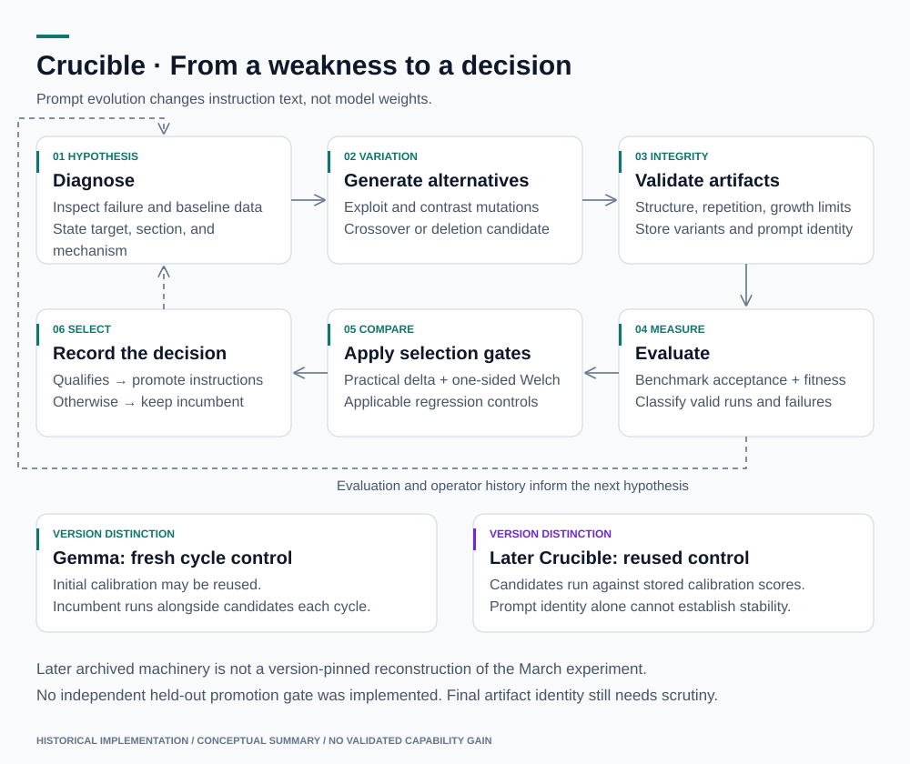

# Crucible Evolution Pipeline

[Case study](README.md)

The diagram summarizes the historical workflow. The selected code demonstrates individual operations; this package does not distribute the full execution pipeline.

For the mutation hypotheses, exact fitness weights, promotion equations, calibration behavior, and concrete benchmark checks, see [Mutation Design, Fitness, and Promotion](methodology.md).

## Baseline policy evolved

Gemma evaluated a fresh baseline alongside candidates under each cycle's run plan, combining trusted-core comparisons with regression coverage and a director veto reapplied after confirmation. The later Crucible archive reused stored calibration as its control. The diagram abstracts both versions; it does not imply that every cycle performed a complete fresh calibration. See the [version-specific regression account](methodology.md#fresh-cycle-controls-and-regression-protection-in-gemma).

## What changes and what should stay fixed

The manipulated variable is the agent's instruction text. A meaningful comparison also needs a stable model/execution configuration, benchmark specification, budget, evaluation logic, and memory policy. Archived metadata preserves some of these details; the [evidence limitations](experiment.md#limits-on-interpretation) identify what cannot be reconstructed for the example.

## Implemented controls and their limits

| Control | Intended purpose | Limit |
|---|---|---|
| Prompt hashes and stored variants | Identify the actual instruction text | The featured crossover metadata and artifact disagree; an identifier alone is not enough |
| Mutation validation | Reject unchanged text, malformed headings, repetition, and excessive growth | Local validation does not guarantee that a composed final prompt differs from baseline |
| Run-state classification | Separate valid capability results from runner failures and timeouts | Excluding invalid results also requires reporting reliability separately |
| Acceptance and composite fitness | Assess functional checks alongside other signals | Fitness is not a task-success probability; thresholds and judge contributions matter |
| Statistical improvement and regression checks | Avoid promoting on a favorable mean alone | Small samples, adaptive selection, and missing coverage weaken the decision |
| Observational benchmark refresh | Expose possible drift beyond promotion-driving tasks | A scheduled refresh is not a working held-out promotion gate |

The preserved [selection functions](src/evolution.py) contain a one-sided Welch gate plus a minimum difference, and a per-benchmark regression floor. They are excerpts from the archived implementation, not a reconstructed proof of which gate ended the featured cycle. Missing benchmark scores are skipped by the regression helper, and zero-variance samples return a non-promoting result in the statistical helper.

## Roles of models

Models generated proposed instruction changes, executed benchmark tasks, and could supply quality assessments. Functional acceptance checks provided a distinct signal. A model's own assessment or persuasive mutation rationale did not independently demonstrate improved capability.

## Preserved scope

This package contains reviewed prompts, selected numeric records, pure-logic excerpts, and an offline inspection script. It omits runtime workspaces, credentials, deployment configuration, and live model runners. The historical prompt files retain generic container references as evidence; they are not setup instructions for this sample.
