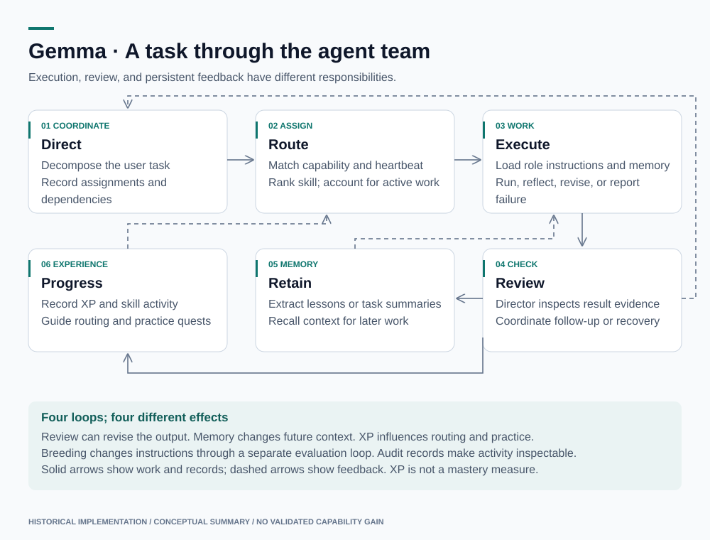
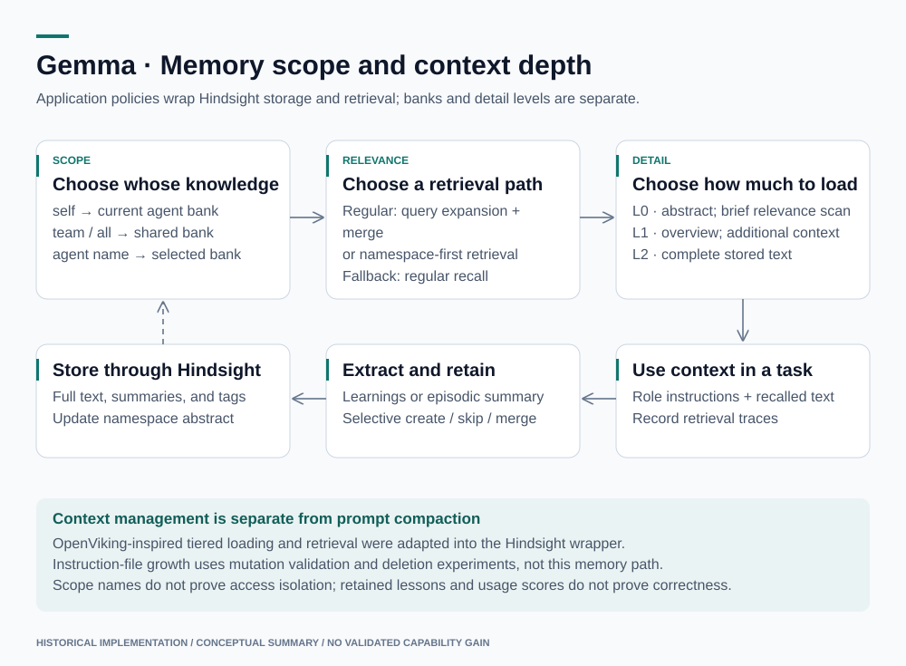

# Gemma Architecture and Task Lifecycle

[Case study](README.md)

This is a simplified view of the historical implementation. It shows responsibilities and information flow, not a live deployment or a guarantee of successful execution.



The memory and progression arrows represent implemented paths. They do not establish that stored lessons are correct or that a higher score improves future task outcomes.

## Component responsibilities

| Component | Responsibility | Included evidence |
|---|---|---|
| Director and worker runners | Assign tasks, check dependencies, execute work, report results, handle cancellation and timeouts | Historical workflow summarized here; live runners are not distributed |
| Capability registry | Identify agents that declare the requested capabilities and have a recent heartbeat | [Registry excerpts](src/capability_registry.py) |
| Routing | Rank capable, online specialists using skill scores and a busy-agent penalty | [Routing excerpts](src/routing.py) and [synthetic walkthrough](src/walkthrough.py) |
| Persistent memory | Recall context and retain extracted lessons through Hindsight integration | Architecture description; no live memory service or personal memory data included |
| Progression | Calculate XP rewards, derive scores and tiers, and apply time-based decay | [Progression excerpts](src/progression.py) |
| Dashboard | Present task, agent, memory, quest, and experiment information | Context only; no production screenshots or live service claims |
| Credential proxy and container networks | Intended to mediate outbound access and credential handling | Design context; operational configuration and credentials excluded |

## Memory architecture: scope, detail, and retrieval



Memory was an explicit subsystem with several independent controls. Gemma integrated Hindsight for persistent storage and retrieval; the application added scope selection, context sizing, retrieval policies, and task-to-memory workflows around that service.

| Layer | Implemented behavior | Design purpose |
|---|---|---|
| Ownership | `self` maps to the current agent's bank; `team` maps to a shared bank; an explicit agent name selects that bank | Keep specialist experience separate while allowing shared lessons |
| Project and knowledge type | Project, category, author, role, and namespace tags accompany retained content | Make knowledge attributable and filterable |
| L0: abstract | Default recall returns a short abstract, with a 200-character fallback | Scan relevance without loading every full memory |
| L1: overview | Recall can return a stored overview, with a 2,000-character fallback | Supply more context when an abstract is insufficient |
| L2: full content | Recall returns the complete stored text | Preserve detail for work that needs it |
| Hierarchical retrieval | Search namespace abstracts, select up to three, then retrieve memories within those namespaces | Narrow the search before loading detailed results |

These are two different kinds of layering: banks determine **whose knowledge** is searched; L0/L1/L2 determine **how much text** is returned. The helper's `all` scope maps to the shared bank, not a search across every private bank. Scope names also do not establish an independently verified access-control boundary.

Regular recall optionally generates two alternative queries, merges results by memory ID, and keeps the strongest retrieved score. It then applies a usage boost:

```text
adjusted score = retrieval score × (1 + 0.1 × ln(usage count + 1))
```

Hierarchical recall uses a separate rule:

```text
blended score = 0.5 × namespace score + 0.5 × memory score
```

It falls back to regular recall when namespace abstracts are unavailable. The inspected hierarchical path does not also apply the regular path's usage boost. These policies encode a preference for relevant, reusable knowledge; they do not prove that frequently retrieved knowledge is correct.

### How completed work becomes memory

The task runner stores explicit learnings as skill memories, or a task summary as episodic memory when explicit learnings are absent. A separate extraction helper asks for up to three reusable patterns or concrete problem–solution cases. Storage can generate L0 and L1 summaries while retaining the full content and updating a namespace abstract.

Deduplication is selective: patterns, semantic knowledge, and preferences are mergeable categories. The helper retrieves similar memories and, above its default 0.85 score threshold, asks a model to create, skip, or merge. A merge writes combined content and a best-effort supersession note; it is not an atomic replacement that guarantees removal of the old record. Cases and other categories can be retained separately. Failed summarization or deduplication falls back to ordinary storage.

The integration also exposes reflection over stored knowledge. Task self-reflection is another path: inspect an output, identify issues, and optionally revise it before completion. Retrieval logs record query, scope, detail level, scores, and timing. This made memory behavior inspectable, while leaving an evaluation question: did the retrieved lesson actually improve the next task? No token-savings or task-quality gain is established by this portfolio sample.

### OpenViking-inspired context management

The source documentation names **OpenViking** as the inspiration for the tiered loading, namespace retrieval, structured memory types, deduplication, query expansion, and skill extraction implemented in the Hindsight wrapper. This was an adaptation of context-management ideas into the application, rather than a demonstrated fork of OpenViking or a replacement for Hindsight's core retrieval system.

That work controlled how stored knowledge entered the model's context. Instruction-file growth was handled separately by section-aware mutation, repetition checks, growth limits, and deletion/knockout experiments on `SKILL.md`. Both addressed context overhead, but the memory wrapper did not act as a general Markdown-file compactor.

The later Crucible memory wrapper added a maintenance lifecycle: semantic clustering and merging for eligible categories, old-and-unused memory flagging, dry-run reports, and a lock-file check intended to avoid overlapping passes. Its default trigger required five completed sessions and 24 hours since the previous consolidation, with a force option. The task runner called the gated maintenance helper after recording a session. Stale memories were flagged rather than deleted; merged originals received best-effort supersession records. These are implemented maintenance mechanisms, not evidence of a measured reduction in context cost.

## Execution and evaluation architecture

The director and specialists exchanged file-based task and result records. Dependency checks determined when work could start; capability declarations, heartbeats, skill scores, and busy status informed routing. Worker execution added timeouts, cancellation handling, audit events, optional reflection, and post-task learning. The dashboard exposed these operational records. Credential mediation and container networks were additional deployment components; they are not reproduced or security-validated here.

The system had several distinct feedback loops:

| Loop | What changes | Evidence collected |
|---|---|---|
| Task execution and reflection | The current output | Results, failures, revision records |
| Persistent memory | Context available to later tasks | Lessons, cases, retrieval traces |
| Practice quests and XP | Progression records and future task eligibility | Acceptance results, quality ratings, reward breakdowns |
| Breeding | The agent's instruction text | Baseline calibration, candidate artifacts, benchmark scores, promotion decisions |

Separating these loops matters experimentally: a stronger result after changing both instructions and remembered context cannot identify which change helped.

## What the director benchmarks actually tested

The inspected Gemma suite contains ten scenario definitions: full-stack decomposition, dependency resolution, routing conflict, escalation triage, stalled-task recovery, budget-constrained planning, priority rebalancing, cross-agent review, quality-gate review, and memory curation. They supplied scenario data and starter files, then evaluated generated artifacts with acceptance checks and a judging rubric.

Two examples show the intended depth:

- **Decomposition:** produce task records against a supplied capability registry. Checks inspect required fields, valid agent assignments, coverage of specialties, dependency references, cycles, sequencing, and scope boundaries. This tests the director's plan as a structured artifact rather than merely asking whether its prose sounds sensible.
- **Memory curation:** read six agent results, existing memories, and skill records; decide which lessons belong in shared versus private memory; propose justified XP updates; summarize the project; and identify a seeded contradiction with prior knowledge. The scenario tests the connection between coordination, memory, and progression.

### Baseline and regression protection during breeding

The inspected Gemma runner included the incumbent baseline as a participant in every cycle's evaluation plan. New candidates therefore competed against freshly collected control scores, while scheduled regression tasks checked behavior beyond the immediate mutation target. Initial calibration could be reused; the fresh cycle-level control was a separate execution step.

Promotion arithmetic admitted only valid results on trusted core benchmarks. Calibration trust required at least two valid runs, and the runner required three trusted core benchmarks before breeding. For the director, an evaluated regression run below 0.5 acceptance vetoed promotion, and confirmation reruns could not bypass that gate. The [methodology](../crucible/methodology.md#fresh-cycle-controls-and-regression-protection-in-gemma) details the limits on coverage and the later Crucible change to calibration reuse.

A benchmark specification is not itself proof of complete behavioral coverage. Some checks inspect strings or file structure; judging rubrics add interpretation. Historical definition tests checked valid JSON, required keys, supported check types, starter data, and coverage of director skills. Separate breeding tests checked director-specific weights and their normalization. Those original test files were inspected for this narrative, not rerun here; the portfolio's six offline checks cover only the distributed extracts.

## Routing example

For a task requiring API design, the walkthrough supplies two available agents with scores of 70 and 60. The first is selected. When the first has an active task, the historical 20-point penalty reduces its routing score to 50, and the second is selected.

This demonstrates the policy, not the validity of the input skill ratings. The registry defaults to a score of 50 when suitable skill data is unavailable, so missing evidence can still produce a favorable ranking. A future policy would need to distinguish missing evidence from demonstrated ability.

## Experience and practice

The progression formula combines task complexity, assessed quality, help received, and work source. An exponential threshold table converts cumulative XP to a score. The historical implementation uses the score to assign tiers; other parts of the system use skill information in prompts and practice selection.

The inspected scheduler uses the agent's highest skill score to set its maximum quest tier, then favors weaker skills when choosing quests. That can allow strength in one area to unlock difficulty in another. The [retrospective](retrospective.md) discusses why per-skill evidence matters.

### The progression formula

The included implementation makes the policy explicit:

```text
successful-task XP = max(1, round(complexity XP × quality × help × source))
failure XP        = max(1, round(complexity XP × 0.15 × source))
XP needed for score n = round(10 × (1.063^n − 1) / 0.063)
```

Complexity awards range from 2 to 13 base XP. Source multipliers are 1.0 for tasks, 0.75 for chat, 0.5 for quests, and 0.25 for breeding. Quality and help multipliers modulate the award; progressively larger cumulative XP thresholds slow score growth. Tiers begin at scores 0, 25, 50, and 75. These are designed progression incentives, distinct from the statistical decision to promote a prompt in Crucible.

The minimum-one rule also gives XP when full escalation makes the help multiplier zero. Together with failure rewards and the decay behavior discussed in the retrospective, this illustrates why the system's experience score cannot be treated as a capability measurement.

## System boundaries

Task execution can involve generated code and external services. File paths and timeouts alone are not a secure execution sandbox. The offline examples here perform no model calls, execute no generated code, and do not reproduce or validate the original isolation architecture.
